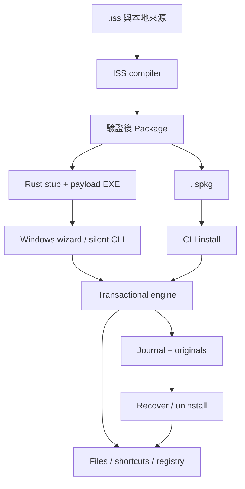

# IronSetup 架構與資料格式

## 五個 crate

| Crate | 責任 | 不負責的範圍 |
| --- | --- | --- |
| `ironsetup-core` | 版本化 manifest、bounded package codec、SHA-256、SFX trailer、路徑檢查、選擇式 parser | 不接觸 Registry／UI |
| `ironsetup-compiler` | ISS tokenizer／parser／預處理、來源定位、檔案遍歷、編譯成 Package | 不呼叫外部 Inno 編譯器、不寫安裝目的地 |
| `ironsetup-engine` | 安裝規劃／選擇、平台路徑、寫前 journal、回復、解除安裝、Windows 整合 | 不擁有 UI message loop |
| `ironsetup-ui` | Win32 工作室與精靈、native dialogs、worker channel、主執行緒控制項狀態 | 透過 callback 注入業務行為，不重寫安裝引擎 |
| `ironsetup` | CLI、stub bootstrap、UAC／自身解除安裝重啟、log、crate 整合 | 不將格式驗證與 UI 狀態耦合 |

## 自有封裝格式 v1

`IRNPKG01` magic → little-endian u64 manifest 長度 → UTF-8 JSON manifest → 依 manifest 順序的 payload → 整體 SHA-256。

每份 payload：method byte（0＝stored、1＝zlib/deflate）→ u64 未壓縮長度 → u64 儲存長度 → data。manifest 含每份檔案的目標相對路徑、大小、SHA-256、執行權限與選項。codec 拒絕未知 schema 欄位、長度不符、多餘尾資料、未支援 format、重複目的地與不安全路徑。

SFX EXE：原始 stub → package bytes → u64 package 長度 → package SHA-256（32 bytes）→ `IRONSETUP-SFX-01`（16 bytes）。stub 從自身尾端定位封裝；解除安裝器只複製 stub 部分，不複製應用 payload。Trailer 依賴 EOF，因此本版沒有後追加 Authenticode 憑證的支援。

不是 ZIP 容器。壓縮是 deflate，`.iss` 的 `Compression=zip` 只選擇該壓縮演算法。建立 ZIP 是最後的開發工具交付包裝，與安裝 payload 格式分開。

## 寫入與恢復

讀取完整封裝並驗證 → 選擇與平台預檢 → 取得排他鎖 → 建立 journal／原始備份 → 逐項寫入 → 標記 committed → 執行可選 `[Run]`。

每次檔案或 Registry 變更先持久記錄還原資訊。同步錯誤觸發 rollback；程序被中止後可用 `recover` 處理未完成 journal。原始備份只有在回復／解除安裝不再需要它時清理。已提交的 `[Run]` 外部副作用不在 rollback 範圍內。

解除安裝不使用對整個 app root 的 `remove_dir_all`。對每個記錄檢查目前 digest／原始 digest／權限，決定刪除、還原、保留或保留備份。只清理由安裝建立且目前為空的目錄。Windows 外部檔案記錄限制為已知使用者資料夾中的 `.lnk`；Linux 拒絕 Windows 外部 root。

## GUI 執行模型

Window procedure 與 HWND 只在 UI 執行緒使用。Build／Install 在 worker 執行；透過 channel 傳進度與結果。timer 推進畫面，commit 期間關閉／取消被擋下，避免 UI 中斷寫入。授權頁的 checkbox 既控制 Next 狀態，也在收到 Next command 時重新檢查。來源檔案若在 editor 外被修改，Save 前提示，不直接覆蓋。

`WizardError::Cancelled`、`WizardError::OperationFailed` 讓 bootstrap 決定退出碼；已在完成頁顯示的失敗不重複跳錯誤視窗。

## 路徑與狀態的邊界

拒絕 traversal、絕對 payload 路徑、ADS colon、Windows device names、尾端空白／句點、目錄與檔案衝突、symbolic links 與 Windows reparse points。常用 Windows 資料夾透過 Known Folder API 取得；捷徑使用 COM，Registry 使用 Win32 API。

這些是檔案安全檢查，不是對同帳號惡意程式的完整隔離，也不是加密簽章。具有相同寫入權限的程式仍可修改未受保護的 journal、payload 或 executable。檔案系統競態、斷電與特殊檔案系統需要更多原生平台測試。

## 套件取捨

使用 Rust 2021 edition、Cargo workspace、serde／serde_json、sha2、flate2、tempfile、windows／windows-sys。原生控制項讓 Windows 便攜版不依賴 WebView2、Node.js 或網頁前端服務。引擎與編譯器可在 Linux 測試，Windows 平台操作由 `cfg(windows)` 隔離。
